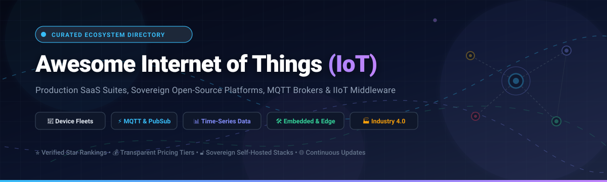

# 🌐 Awesome Internet of Things (IoT) Ecosystem

<p align="center">
  
</p>

<p align="center">
  <a href="https://github.com/ishandutta2007/Awesome-Awesome-Awesome"></a><a href="https://discord.gg/jc4xtF58Ve"></a>
  <a href="https://github.com/ishandutta2007/Awesome-Internet-Of-Things-IOT/stargazers"></a>
  <a href="https://github.com/ishandutta2007/Awesome-Internet-Of-Things-IOT/network/members"></a>
  <a href="https://github.com/ishandutta2007/Awesome-Internet-Of-Things-IOT/blob/main/LICENSE"></a>
  <a href="https://github.com/ishandutta2007/Awesome-Internet-Of-Things-IOT/pulls"></a>
  <a href="https://github.com/ishandutta2007"></a>
</p>

---

## 📌 Executive Summary & Architecture Scope

The **Internet of Things (IoT)** ecosystem represents the convergence of embedded physical hardware, real-time wireless telemetry, scalable cloud message ingestion, and operational automation. This curated repository provides a comprehensive technical index of industry-leading **Enterprise SaaS Platforms** and sovereign **Open-Source GitHub Projects**.

Whether architecting low-power smart sensors on ESP32 microcontrollers, ingesting multi-million device message streams over **MQTT 5.0**, orchestrating containerized edge microservices via **EdgeX Foundry**, or automating industrial production lines using **OPC UA & Modbus**, this guide covers production-ready tools for engineers, IoT architects, and systems integrators.

---

## 📑 Table of Contents

- [📊 Sector Overview & Market Dynamics](#-sector-overview--market-dynamics)
- [☁️ Top SaaS & Enterprise IoT Platforms](#️-top-saas--enterprise-iot-platforms)
- [💻 Open-Source IoT Projects & Frameworks](#-open-source-iot-projects--frameworks)
  - [🏆 Open-Source Quick Comparison](#-open-source-quick-comparison)
  - [🔍 In-Depth Open-Source Project Details](#-in-depth-open-source-project-details)
- [📡 IoT Connectivity & Protocol Matrix](#-iot-connectivity--protocol-matrix)
- [🤝 How to Contribute](#-how-to-contribute)
- [💖 Support & Community](#-support--community)
- [##  Star History](#--star-history)
- [⚖️ Disclaimer & Compliance](#️-disclaimer--compliance)

---

## 📊 Sector Overview & Market Dynamics

- **Estimated Market Size**: The global Internet of Things (IoT) market is valued at approximately **$900 Billion to $1.05 Trillion in 2026** and is projected to surpass **$3.2 Trillion by 2033**, compounding at an annual growth rate (CAGR) of **12.2% to 23.1%**.
- **Market Structure & Fragmentation**: The IoT industry exhibits **moderate-to-high fragmentation** across physical hardware sensors, fieldbus gateways, edge protocol gateways, and vertical-specific applications (e.g., connected fleet operations, building energy management, predictive factory maintenance). While hyperscale cloud providers (AWS, Microsoft Azure, Google Cloud) concentrate general-purpose message brokering and persistent time-series storage, there is **no single winner-take-all platform**—leaving abundant room for specialized IIoT suites and sovereign, self-hosted open-source stacks.

---

## ☁️ Top SaaS & Enterprise IoT Platforms

The following enterprise IoT platforms offer managed infrastructure for connectivity, digital twins, rule processing, and fleet operations. The table is **sorted descending by company size (Valuation / Market Capitalization)**:

| Platform | Company & Valuation / Revenue | Primary Target & Niche | Specific Starting Pricing | Specific Free Tier / Trial Limit | Key Capabilities & Protocols |
| :--- | :--- | :--- | :--- | :--- | :--- |
| **[Microsoft Azure IoT Hub](https://azure.microsoft.com/en-us/products/iot-hub)** | **Microsoft Corporation**<br>📊 ~$3.10 Trillion Market Cap<br>💵 $245B Annual Revenue | Enterprise cloud device connectivity, twins, and edge runtime | **$10.00 / month**<br>(Basic Tier B1: 400,000 msgs/day; or Standard S1 at $25.00/mo) | **Free forever (F1 Free Tier)**:<br>Up to 500 registered devices, 8,000 messages/day (0.5 KB blocks), 1 free hub per subscription | Bi-directional messaging, per-device X.509 auth, IoT Edge module distribution, AMQP/MQTT/HTTPS |
| **[Google Cloud IoT Solutions](https://cloud.google.com/solutions/iot)** | **Alphabet Inc. (Google)**<br>📊 ~$2.10 Trillion Market Cap<br>💵 $350B Annual Revenue | Hyperscale telemetry streaming, Dataflow & BigQuery pipelines | **$40.00 per TiB**<br>($0.039 per GiB for Pub/Sub ingestion throughput) | **Free forever (Always Free)**:<br>10 GiB of message delivery per month + $300 new-account credit valid for 90 days | Pub/Sub message broker, partner MQTT gateways, real-time AI/ML BigQuery telemetry analysis |
| **[AWS IoT Core](https://aws.amazon.com/iot-core/)** | **Amazon.com, Inc. (AWS)**<br>📊 ~$1.95 Trillion Market Cap<br>💵 $600B Amazon / $105B AWS | Scalable device management, telemetry routing & device shadows | **$1.00 per 1M messages**<br>(first 1B msgs) + $0.08 per 1M connectivity minutes | **12-Month Free Tier**:<br>500,000 messages/month, 2,250,000 connection minutes/mo, 250,000 rules triggered/mo | MQTT 3.1.1/5.0, WebSockets, HTTPS, AWS Lambda serverless rules engine, LoRaWAN Core |
| **[Cisco IoT Control Center](https://www.cisco.com/)** | **Cisco Systems, Inc.**<br>📊 ~$230 Billion Market Cap<br>💵 $54B Annual Revenue | Global cellular IoT connectivity, SIM automation & fleet security | **$5.00 – $6.00 / SIM / month**<br>(Essentials plan via carrier partner networks) | **60-Day Carrier Partner Trial**:<br>Up to 5 test SIM cards, 50 MB cellular data/SIM, 30 SMS + perpetual DevNet sandbox (5 req/s) | Global SIM lifecycle management, automated anomaly detection, IMEI lock, telecom carrier peering |
| **[ServiceNow Connected Operations](https://www.servicenow.com/)** | **ServiceNow, Inc.**<br>📊 ~$180 Billion Market Cap<br>💵 $10B Annual Revenue | IT/OT convergence, automated ticket routing & field service | **$100.00 / user / month**<br>(Entry fulfiller license, ~$10,000/yr platform threshold) | **Free forever Personal Developer Instance (PDI)**:<br>Full Now Platform with Connected Operations plugins (subject to 10-day idle reclamation) | CMDB OT asset mapping, event-driven incident creation, industrial sensor alerting, field technician dispatch |
| **[Siemens Insights Hub](https://siemens.com/)** *(formerly MindSphere)* | **Siemens AG**<br>📊 ~$160 Billion Market Cap<br>💵 $85B Annual Revenue | Industrial IoT operating system, condition monitoring & digital twins | **$2,500.00 / month**<br>(~$30,000/year base industrial tenant & connector package) | **Free forever ("Start for Free" Tier)**:<br>1 to 3 live machine connections, baseline Operations Insight dashboards, near real-time telemetry | Native Siemens S7 PLC drivers, MindConnect edge boxes, OPC UA, industrial asset performance analytics |
| **[Samsara Connected Operations](https://www.samsara.com/)** | **Samsara Inc.** *(NYSE: IOT)*<br>📊 ~$26 Billion Market Cap<br>💵 $1.2B Annual Revenue | Commercial fleet telematics, GPS asset tracking & driver safety | **$27.00 – $33.00 / vehicle / month**<br>(Software telematics tier; hardware amortized/purchased) | **30-Day Hardware/Software Free Trial**:<br>Hardware evaluation kit for 2 to 5 vehicles with full diagnostic telematics dashboard access | Real-time GPS tracking, AI dashcam accident analysis, CAN bus engine diagnostics, cold-chain sensors |
| **[PTC ThingWorx](https://www.ptc.com/en/products/thingworx)** | **PTC Inc.** *(NASDAQ: PTC)*<br>📊 ~$22 Billion Market Cap<br>💵 $2.2B Annual Revenue | Industrial IoT application enablement, AR integration & manufacturing | **$4,166.00 / month**<br>(~$50,000/year base ThingWorx Foundation platform license) | **30-Day Hosted Developer Trial**:<br>Full cloud developer tenant, REST API access, and simulated Kepware PLC industrial tags | Kepware industrial protocol translation (OPC UA, Modbus), drag-and-drop mashup builder, Vuforia AR |
| **[Software AG Cumulocity IoT](https://www.softwareag.com/)** | **Software AG / Silver Lake**<br>📊 ~$2.60 Billion Valuation<br>💵 $1.0B Annual Revenue | Rapid IoT application enablement, multi-tenancy & edge computing | **$500.00 / month**<br>(Starter Pack entry tier / Commit-to-Consume baseline) | **30-Day Free Trial**:<br>Up to 10 connected devices, full core platform features, telemetry measurement & alarm processing | Multi-tenant tenant hierarchy, Cumulocity Streaming Analytics (Apama), lightweight device agent C++ SDK |
| **[Particle IoT Platform](https://www.particle.io/)** | **Particle Industries**<br>📊 ~$500 Million Valuation<br>💵 $81M VC Funding | Integrated cellular/Wi-Fi hardware, device cloud & firmware OTA | **$299.00 / month**<br>(Basic tier: up to 1,000 devices and 1.5M operations/month) | **Free forever (Sandbox Plan)**:<br>Up to 100 devices (Wi-Fi or Cellular), 100,000 data operations/mo, 100 MB cellular data/mo | Microcontroller hardware modules (Boron, Argon, Photon 2), Device OS, over-the-air firmware updates, Webhooks |

---

## 💻 Open-Source IoT Projects & Frameworks

Open-source IoT software enables organizations to retain complete data sovereignty, eliminate per-device cloud fees, customize data transformation pipelines, and deploy on-premises, at the edge, or in self-hosted Kubernetes clusters.

### 🏆 Open-Source Quick Comparison

The following table includes all featured open-source repositories **sorted descending by GitHub Stars_Count**:

| Rank | Project & Repository | GitHub_Stars | Architecture & Core Tech | Primary Protocols | Best Used For |
| :---: | :--- | :---: | :--- | :--- | :--- |
| **1** | **[Home Assistant](https://github.com/home-assistant/core)** | [](https://github.com/home-assistant/core/stargazers) | Python, Asyncio, SQLite/PostgreSQL | MQTT, Zigbee, Z-Wave, Matter, HTTP | Local-first smart home & building sensor automation |
| **2** | **[Node-RED](https://github.com/node-red/node-red)** | [](https://github.com/node-red/node-red/stargazers) | Node.js, Flow-based Visual Runtime | MQTT, HTTP, WebSockets, Modbus, TCP | Visual event-driven logic & hardware integration |
| **3** | **[ThingsBoard](https://github.com/thingsboard/thingsboard)** | [](https://github.com/thingsboard/thingsboard/stargazers) | Java, Netty, PostgreSQL/Cassandra | MQTT, CoAP, HTTP, LwM2M | Turnkey enterprise IoT platform & rule chains |
| **4** | **[EMQX](https://github.com/emqx/emqx)** | [](https://github.com/emqx/emqx/stargazers) | Erlang/OTP, BEAM, Distributed Cluster | MQTT 3.1.1/5.0, MQTT-SN, CoAP | High-throughput broker handling 100M+ connections |
| **5** | **[ESPHome](https://github.com/esphome/esphome)** | [](https://github.com/esphome/esphome/stargazers) | C++, Python, YAML Configuration | Native API, MQTT, BLE | No-code sensor firmware compilation for ESP8266/ESP32 |
| **6** | **[Eclipse Mosquitto](https://github.com/eclipse/mosquitto)** | [](https://github.com/eclipse/mosquitto/stargazers) | C, Single-threaded Event Loop | MQTT 3.1, 3.1.1, 5.0, WebSockets | Ultra-lightweight edge & gateway MQTT message routing |
| **7** | **[dgiot](https://github.com/dgiot/dgiot)** | [](https://github.com/dgiot/dgiot/stargazers) | Erlang/OTP, TDengine Time-Series | Modbus, OPC UA, BACnet, MQTT | Million-device industrial protocol aggregation |
| **8** | **[Mongoose OS](https://github.com/cesanta/mongoose-os)** | [](https://github.com/cesanta/mongoose-os/stargazers) | C, JavaScript (mJS), FreeRTOS | MQTT, WebSockets, HTTPS | Microcontroller firmware framework with OTA & crypto |
| **9** | **[Magistrala](https://github.com/absmach/magistrala)** | [](https://github.com/absmach/magistrala/stargazers) | Go, Microservices, NATS, Redis | MQTT, CoAP, HTTP, WebSocket | Cloud-native modular IoT messaging backbone (LF Edge) |
| **10** | **[EdgeX Foundry](https://github.com/edgexfoundry/edgex-go)** | [](https://github.com/edgexfoundry/edgex-go/stargazers) | Go, Dockerized Microservices | REST, MQTT, Modbus, BACnet, OPC UA | Vendor-neutral edge computing interoperability framework |
| **11** | **[openHAB](https://github.com/openhab/openhab-core)** | [](https://github.com/openhab/openhab-core/stargazers) | Java, OSGi Modular Architecture | KNX, EnOcean, Z-Wave, MQTT, HTTP | Vendor-neutral enterprise & home automation platform |
| **12** | **[ChirpStack](https://github.com/chirpstack/chirpstack)** | [](https://github.com/chirpstack/chirpstack/stargazers) | Rust, PostgreSQL, Redis | LoRaWAN 1.0.x / 1.1, MQTT | Self-hosted LoRaWAN Network Server stack |
| **13** | **[nodrix](https://github.com/decoded-cipher/nodrix)** | [](https://github.com/decoded-cipher/nodrix/stargazers) | TypeScript, Cloudflare Workers & D1 | HTTPS, WebSockets | Serverless edge IoT platform with native MCP AI server |
| **14** | **[NAOS](https://github.com/256dpi/naos)** | [](https://github.com/256dpi/naos/stargazers) | C, ESP-IDF, CLI in Go | MQTT, BLE, WebSocket, OSC | Networked ESP32 device firmware toolkit with live logs |
| **15** | **[MapexOS](https://github.com/Mapex-Solutions/mapexOS)** | [](https://github.com/Mapex-Solutions/mapexOS/stargazers) | TypeScript, Docker, Temporal DAG | MQTT, HTTP, LoRaWAN | Multi-tenant platform with visual DAG workflows |
| **16** | **[DeviceSDK](https://github.com/device-sdk/devicesdk)** | [](https://github.com/device-sdk/devicesdk/stargazers) | TypeScript, SQLite, Single-Container | WebSockets, mDNS | Edge runtime for ESP32 and Raspberry Pi Pico |
| **17** | **[EsoCore](https://github.com/newmatik/EsoCore)** | [](https://github.com/newmatik/EsoCore/stargazers) | Python (Django), Nuxt.js, STM32 | Modbus RTU, RS-485, REST | Open-source factory machine condition monitoring stack |

---

### 🔍 In-Depth Open-Source Project Details

#### 1. 🏠 [Home Assistant](https://github.com/home-assistant/core) [](https://github.com/home-assistant/core/stargazers)
- **Primary Focus**: Local-first home and facility automation with privacy at its foundation.
- **Key Architecture**: Written in Python with an asynchronous core; supports over 2,000 modular integrations spanning temperature sensors, power meters, smart plugs, cameras, and heating systems.
- **Deployment**: Runs on Raspberry Pi, Home Assistant Green, Docker containers, or x86 server hardware via Home Assistant OS.
- **License**: Apache 2.0.

#### 2. 🔀 [Node-RED](https://github.com/node-red/node-red) [](https://github.com/node-red/node-red/stargazers)
- **Primary Focus**: Flow-based visual programming tool for connecting physical IoT hardware devices, web APIs, and online databases.
- **Key Architecture**: Lightweight Node.js event-driven runtime; features a browser-based flow editor with an ecosystem of over 4,000 community nodes for Modbus, OPC UA, MQTT, and Bluetooth.
- **Deployment**: Deploys on Raspberry Pi, industrial edge gateways, Docker, and Kubernetes clusters.
- **License**: Apache 2.0.

#### 3. 📊 [ThingsBoard](https://github.com/thingsboard/thingsboard) [](https://github.com/thingsboard/thingsboard/stargazers)
- **Primary Focus**: Comprehensive, full-featured IoT application enablement platform (AEP) for device fleet management and real-time visualization.
- **Key Architecture**: High-performance Netty server architecture storing time-series measurements in PostgreSQL, Cassandra, or TimescaleDB; features drag-and-drop rule engine nodes for alert routing and alarm generation.
- **Deployment**: Single-node Docker deployment up in under 10 minutes; microservices mode scales out with Kubernetes.
- **License**: Apache 2.0 (Community Edition).

#### 4. ⚡ [EMQX](https://github.com/emqx/emqx) [](https://github.com/emqx/emqx/stargazers)
- **Primary Focus**: Distributed, fault-tolerant MQTT messaging broker designed for massive telemetry throughput.
- **Key Architecture**: Built on the Erlang/OTP BEAM virtual machine; handles up to 100 million concurrent MQTT client connections per cluster with sub-millisecond routing latency and native SQL-based rule evaluation.
- **Deployment**: Standalone Linux binaries, Docker containers, Helm charts on Kubernetes.
- **License**: Apache 2.0 (Community Edition).

#### 5. 🛠️ [ESPHome](https://github.com/esphome/esphome) [](https://github.com/esphome/esphome/stargazers)
- **Primary Focus**: Declarative firmware generator for ESP8266 and ESP32 microcontrollers without writing C++ code.
- **Key Architecture**: Define sensors, displays, relays, and connectivity in simple YAML configuration files; ESPHome automatically compiles optimized C++ firmware and flashes it over USB or over-the-air (OTA).
- **Deployment**: Python CLI, Home Assistant Add-on, or standalone Docker container.
- **License**: Dual GPL-v3 / MIT.

#### 6. 🦟 [Eclipse Mosquitto](https://github.com/eclipse/mosquitto) [](https://github.com/eclipse/mosquitto/stargazers)
- **Primary Focus**: Ultra-lightweight, high-efficiency MQTT protocol message broker.
- **Key Architecture**: Implemented in clean C with minimal memory overhead (typically under 10 MB RAM); strictly complies with MQTT version 5.0, 3.1.1, and 3.1 specifications.
- **Deployment**: Runs on constrained embedded Linux routers, OpenWrt boxes, Raspberry Pi edge gateways, and micro-containers.
- **License**: Eclipse Public License 2.0.

#### 7. 🏭 [dgiot](https://github.com/dgiot/dgiot) [](https://github.com/dgiot/dgiot/stargazers)
- **Primary Focus**: Open-source industrial IoT (IIoT) aggregation engine built for million-device industrial scale.
- **Key Architecture**: Erlang/OTP architecture integrated with TDengine high-speed time-series storage; ships with protocol decoders for over 300 industrial standards (Modbus, OPC UA, DL/T645, CJ/T188, BACnet).
- **Deployment**: One-click Docker Compose deployment completes in ~6 minutes.
- **License**: Apache 2.0.

#### 8. 📦 [Mongoose OS](https://github.com/cesanta/mongoose-os) [](https://github.com/cesanta/mongoose-os/stargazers)
- **Primary Focus**: Complete firmware development environment and runtime for low-power commercial microcontrollers.
- **Key Architecture**: Provides hardened mbedTLS encryption, dual-bank flash memory for fail-safe OTA updates, and pre-integrated cloud connectors for AWS IoT, Azure IoT, and Google Cloud; code in C or embedded JavaScript (mJS).
- **Deployment**: Flashes to ESP32, ESP8266, STM32, and TI CC3220 chips via `mos` CLI.
- **License**: Apache 2.0 (Community Edition).

#### 9. 🔌 [Magistrala](https://github.com/absmach/magistrala) *(formerly Mainflux)* [](https://github.com/absmach/magistrala/stargazers)
- **Primary Focus**: Linux Foundation Edge hosted, cloud-native IoT microservices backbone.
- **Key Architecture**: Written in Go using event-driven microservices interconnected via NATS message bus; exposes uniform REST, MQTT, WebSocket, and CoAP protocol adapters with granular mTLS and JWT identity control.
- **Deployment**: Docker Compose and Kubernetes Helm charts.
- **License**: Apache 2.0.

#### 10. 🌐 [EdgeX Foundry](https://github.com/edgexfoundry/edgex-go) [](https://github.com/edgexfoundry/edgex-go/stargazers)
- **Primary Focus**: Vendor-neutral open-source edge computing middleware framework under the Linux Foundation Edge umbrella.
- **Key Architecture**: Modular Go microservices divided into Core Services, Supporting Services, and Device Services; normalizes disparate protocols (Modbus, OPC UA, REST, MQTT) into unified edge telemetry before forwarding upstream.
- **Deployment**: Containerized Docker and Snap deployments on edge appliances.
- **License**: Apache 2.0.

#### 11. 💡 [openHAB](https://github.com/openhab/openhab-core) [](https://github.com/openhab/openhab-core/stargazers)
- **Primary Focus**: Pure Java-based, vendor-neutral automation platform for buildings, sensors, and peripherals.
- **Key Architecture**: Built upon the OSGi modular framework; provides vendor-independent abstraction layers for protocols like KNX, EnOcean, Z-Wave, Zigbee, and MQTT.
- **Deployment**: Multi-platform JVM support (Linux, macOS, Windows, Raspberry Pi).
- **License**: Eclipse Public License 2.0.

#### 12. 📻 [ChirpStack](https://github.com/chirpstack/chirpstack) [](https://github.com/chirpstack/chirpstack/stargazers)
- **Primary Focus**: Open-source LoRaWAN Network Server stack for long-range, low-power private networks.
- **Key Architecture**: Written in Rust for speed and minimal memory footprint; manages LoRaWAN gateway communication, device activations (OTAA/ABP), deduplication, and payload encryption before publishing to MQTT.
- **Deployment**: Docker Compose or standalone Rust binaries with PostgreSQL and Redis.
- **License**: MIT.

#### 13. ☁️ [nodrix](https://github.com/decoded-cipher/nodrix) [](https://github.com/decoded-cipher/nodrix/stargazers)
- **Primary Focus**: Serverless, zero-maintenance IoT platform running in a user's own Cloudflare account.
- **Key Architecture**: Leverages Cloudflare Workers, Durable Objects, D1 SQL, and R2 storage; includes real-time drag-and-drop dashboards, visual automations, and a native Model Context Protocol (MCP) server for direct AI assistant control.
- **Deployment**: Single command deployment using Cloudflare Wrangler CLI.
- **License**: MIT.

#### 14. 📱 [NAOS](https://github.com/256dpi/naos) [](https://github.com/256dpi/naos/stargazers)
- **Primary Focus**: Firmware framework and developer tooling for building robust networked ESP32 connected peripherals.
- **Key Architecture**: ESP-IDF component that automates device parameter synchronization, metrics collection, and live log tailing over MQTT, BLE, and WebSockets; includes a Go CLI and terminal UI.
- **Deployment**: Embedded flashing to ESP32 microcontrollers.
- **License**: Apache 2.0.

#### 15. 🔄 [MapexOS](https://github.com/Mapex-Solutions/mapexOS) [](https://github.com/Mapex-Solutions/mapexOS/stargazers)
- **Primary Focus**: Multi-tenant enterprise IoT platform with visual DAG workflows and dynamic telemetry pipelines.
- **Key Architecture**: Features JavaScript-based data transformation pipelines, an event routing engine inspired by Temporal.io, and granular multi-organization RBAC.
- **Deployment**: Self-hostable via Docker Compose with multi-architecture images for ARM64, Raspberry Pi, and x86.
- **License**: AGPL-3.0.

#### 16. ⚡ [DeviceSDK](https://github.com/device-sdk/devicesdk) [](https://github.com/device-sdk/devicesdk/stargazers)
- **Primary Focus**: Free, self-hosted IoT runtime for writing TypeScript device logic on personal hardware.
- **Key Architecture**: Connects ESP32 and Raspberry Pi Pico microcontrollers over WebSockets; single-container deployment with SQLite persistence, mDNS local discovery, and a CLI for remote code deployment.
- **Deployment**: Single Docker container for Raspberry Pi, NUC, or home NAS.
- **License**: AGPL-3.0.

#### 17. 🎛️ [EsoCore](https://github.com/newmatik/EsoCore) [](https://github.com/newmatik/EsoCore/stargazers)
- **Primary Focus**: Full-stack industrial IoT condition-monitoring system for factory machinery.
- **Key Architecture**: Spans open-source PCB hardware schematics, STM32 embedded firmware, a Django REST API backend, and a modern Nuxt.js dashboard; communicates over Modbus RTU and RS-485.
- **Deployment**: Custom electronics with Docker-based cloud backend.
- **License**: Open Source.

---

## 📡 IoT Connectivity & Protocol Matrix

Selecting the right communication protocol depends on payload frequency, network latency, energy constraints, and packet size:

```
+---------------+---------------------+--------------------+-----------------------+
| Protocol      | Transport / Network | Primary Use Case   | Typical Packet Size   |
+---------------+---------------------+--------------------+-----------------------+
| MQTT 5.0      | TCP / TLS           | Cloud Ingestion    | 10 Bytes – 256 MB     |
| CoAP          | UDP / DTLS          | Low-Power Sensors  | < 1 KB (Constrained)  |
| OPC UA        | TCP / Binary        | Industrial PLCs    | 1 KB – 10 MB          |
| Modbus RTU/TCP| RS-485 / Serial/TCP | Legacy Machinery   | 4 Bytes – 256 Bytes   |
| LoRaWAN       | Sub-GHz RF          | Long-Range Low Pwr | 51 Bytes – 222 Bytes  |
| Matter/Thread | 802.15.4 / IPv6     | Smart Home Nodes   | Compressed IPv6 MTU   |
| WebSockets    | TCP / HTTP Upgrade  | Real-Time UIs      | Unrestricted Stream   |
+---------------+---------------------+--------------------+-----------------------+
```

---

## 🤝 How to Contribute

We welcome contributions from developers, hardware hackers, and enterprise IoT architects!

1. 🍴 **Fork the Repository** on GitHub.
2. 🌿 **Create a Feature Branch**: `git checkout -b feature/add-new-iot-tool`.
3. 📝 **Add or Update Entries**:
   - Ensure software descriptions remain factual, objective, and reference official project documentation.
   - For SaaS tools: Include specific starting price tiers and exact free tier/trial limits.
   - For Open-Source tools: Include the official GitHub repository link and Stars_Badge.
4. 🚀 **Submit a Pull Request** with a concise summary of additions.

> [!TIP]
> Explore more curated software lists across developer toolchains in the [Awesome-Awesome-Awesome](https://github.com/ishandutta2007/Awesome-Awesome-Awesome) directory.

---

## 💖 Support & Community

Thank you for exploring this curated repository! If you find this directory valuable for your IoT projects, enterprise architecture evaluations, or open-source research, please consider supporting the project:

- ⭐ **Star this repository** to boost visibility and help more engineers and makers discover it.
- 🍴 **Fork and contribute** by submitting new SaaS solutions, open-source projects, or benchmark corrections.
- 📢 **Share with peers** on LinkedIn, Twitter/X, Discord, Reddit, and developer forums.
- ☕ **Buy me a coffee / Sponsor**: If this project helped you save hours of research or choose the right IoT stack, support continuous updates and curation via the [GitHub Sponsor Dashboard](https://github.com/sponsors/ishandutta2007). Every sponsorship helps keep this ecosystem directory fresh, accurate, and independent!

---

##  Star History

[](https://star-history.dera.page/#ishandutta2007/Awesome-Internet-Of-Things-IOT&type=date&legend=top-left)

---

## ⚖️ Disclaimer & Compliance

- This repository is a community-curated, vendor-neutral educational guide. Product names, logos, and trademarks belong to their respective corporate owners.
- IoT deployments collecting telemetry, operational sensor data, or personal identifiers must adhere to applicable regulatory frameworks including GDPR, CCPA, and industry cybersecurity standards (such as IEC 62443 and NIST SP 800-213).
- Always verify licensing terms prior to commercial deployment: projects featured range across Apache 2.0, MIT, EPL 2.0, and AGPL-3.0.
